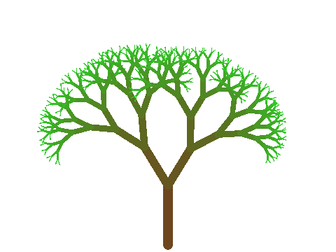
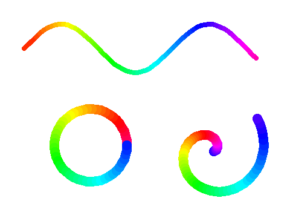

# wasm2sb3

Compiles WebAssembly into a native Scratch 3 project (`.sb3`). Every
WebAssembly function becomes a custom block made of ordinary Scratch blocks:
operators, variables, lists, `if`, `repeat until`. There are no extensions or
JavaScript, so the result runs on scratch.mit.edu, in TurboWarp, or in the
offline editor.

Since C compiles to WebAssembly, real C programs run in Scratch, including
printf, malloc, qsort and libm.

```
$ node bin/wasm2sb3.js examples/queens.c --run
4-queens: 2 solutions
5-queens: 10 solutions
6-queens: 4 solutions
7-queens: 40 solutions
...                     (an ASCII Mandelbrot set follows)
```

## Python in Scratch

`examples/micropython.sb3` is a real Python REPL ([MicroPython](https://micropython.org)
1.29 with floats, bignums, classes, generators, exceptions and `math`),
compiled from C by this compiler into ordinary Scratch blocks. Type at the
"ask" prompt; output scrolls in the list on stage:

```
>>> def fib(n):
...     return n if n < 2 else fib(n - 1) + fib(n - 2)
...
>>> fib(15)
610
>>> 2 ** 100
1267650600228229401496703205376
```

Load it with *File → Load from your computer* in the Scratch editor or
TurboWarp. At ~17 MB of project.json it is too large to *save* to
scratch.mit.edu (the server limit is about 5 MB). The first command takes a
few seconds while Scratch looks up each custom block for the first time;
after that, simple lines take a fraction of a second.

### Python examples

[examples/python/](examples/python/) has Python programs bundled into
projects. Each one runs when you click the green flag:

| | |
|---|---|
|  **spirograph.py**: hypotrochoid curves drawn live by a generator; click for a random one |  **tree.py**: a recursive generator grows a fractal tree; click to grow another |
|  **paint.py**: paint with the mouse in cycling colours; space/b change the brush, c clears |  **snake.py**: steer with the arrow keys, eat apples, don't bite yourself |

**adventure.py** is a small text adventure ("Escape the Stage") played
through the ask box.

Python talks to Scratch through the `scratch` module:

```python
import scratch
scratch.pen_color(255, 0, 0)          # or 0xFF0000; pen_hue(0..100); pen_size(n)
scratch.line(-100, 0, 100, 0)         # also: goto, pen_down, pen_up, dot, stamp, clear
scratch.say("hi")                     # speech bubble
scratch.mouse_x(), scratch.mouse_down(), scratch.key_pressed("left")
scratch.timer(), scratch.clock()      # Scratch timer / wall clock (seconds)
scratch.randint(1, 6)
scratch.on_frame(fn)                  # call fn() every frame, with a screen refresh in between
```

Everything runs in "run without screen refresh" mode, so animations should
do a frame's worth of work in an `on_frame` callback. The examples step a
generator for about 30 ms per frame (measured with `scratch.clock()`).

To build your own, put wasi-sdk and the MicroPython source in `toolchain/`,
then run:

```
python/build.sh my_program.py         # -> python/build/my_program.sb3
python/build.sh --sb3                 # the REPL
```

`node scripts/snapshot.mjs project.sb3 out.png` runs a project headlessly
and saves what the pen drew. It can also script mouse, keyboard and ask-box
input, which is how the previews above were made.

How the port works: [python/](python/) holds a small driver (`main.c`), the
`scratch` module (`modscratch.c`) and a MicroPython configuration. The
garbage collector can run at any time, because every wasm local is a Scratch
variable. The compiled program hands all of them, plus saved call frames, to
MicroPython's GC as roots, together with the C stack in linear memory.

## Why WebAssembly (not LLVM IR)

WebAssembly is a small, stable, fully specified stack machine with about 200
instructions. Its control flow is already structured (`block`/`loop`/`if`,
with no arbitrary gotos), which maps well onto Scratch's C-shaped blocks.
LLVM IR is larger, changes between LLVM versions, and has an unstructured
CFG that would need a "relooper" pass. Any language that targets WebAssembly
(C, C++, Rust, Zig, AssemblyScript, ...) works through this compiler.

## Usage

```
node bin/wasm2sb3.js program.wasm            # -> program.sb3
node bin/wasm2sb3.js program.wat             # text format (needs the wabt package)
node bin/wasm2sb3.js program.c               # C, via wasi-sdk (see below)
node bin/wasm2sb3.js program.c --run         # also run it headlessly in scratch-vm
node bin/wasm2sb3.js prog.c --run --stdin "42"   # input for ask-and-wait
```

Options: `-o out.sb3`, `--entry NAME`, `--cflags "..."`, `--json project.json`, `-q`.

To compile C, unpack [wasi-sdk](https://github.com/WebAssembly/wasi-sdk/releases)
into `./toolchain/` or set `WASI_SDK_PATH`. Or build the `.wasm` yourself:

```
$WASI_SDK/bin/clang -O2 -o prog.wasm prog.c
```

As a library:

```js
import { compileWasm } from './src/index.js';
const { sb3, warnings, stats } = compileWasm(fs.readFileSync('prog.wasm'));
```

### Programs and I/O

| WebAssembly side | Scratch side |
|---|---|
| `_start` / `main` export | runs when the green flag is clicked |
| `_initialize` + `frame` exports (reactor) | `frame` is called once per Scratch frame, for animation |
| WASI `fd_write` (stdout/stderr) | lines appended to the `stdout` list shown on stage |
| WASI `fd_read` (stdin) | "ask and wait"; each answer is one line |
| WASI `proc_exit`, `clock_time_get`, `random_get`, args, environ | supported |
| `scratch.*` imports ([include/scratch.h](include/scratch.h)) | pen, go to x/y, say, mouse, keys, timer, wait |

Examples are in [examples/](examples/): `micropython` (see below), `hello`, `queens`, `guess` (stdin),
and `bounce` (pen animation, built with
`--cflags "-O2 -mexec-model=reactor -Wl,--export=frame"`). The `.sb3` files
next to them are ready to load in Scratch.

## How it works

The pipeline is: binary parser → analyses → per-function code generator →
Scratch block tree → `project.json` + zip.

- **Values.** Scratch only has doubles. An `i32` is held as an unsigned
  integer in [0, 2³²), and an `i64` as two such halves. Wrap-around uses
  `mod 4294967296`. Shifts become multiplications or floored divisions by
  powers of two. `and`/`or`/`xor` use arithmetic identities when one side is a
  constant mask, and otherwise a 256×256 lookup table. Every expression
  carries a known-bits mask, so redundant `mod`s are dropped. `f64` maps
  directly to Scratch numbers. `f32` results are rounded to single precision
  with Veltkamp splitting. Reinterpreting floats as bits uses exact
  power-of-two tables.
- **Memory** is the list `mem`, one 32-bit word per item. Aligned loads and
  stores are a single list read or write. Byte and halfword accesses are done
  arithmetically. Under-aligned accesses go through byte-wise helpers.
- **Expressions, not stack traffic.** The code generator keeps a symbolic
  operand stack, so `a + b * c` becomes one nested reporter. A value is
  written to a variable only when something would change what it reads: a
  store, a call, a write to a local it uses, or a control-flow merge.
- **Control flow.** Branches out of blocks set a `br` variable. The code after
  a branch goes either into the `else` arm of that branch's own `if`, or
  under `if br = 0`. Loops are `repeat until not (br = L)`. A `return` is
  `stop this script`. Blocks that nothing branches to are compiled in line,
  and `br_table` becomes a binary search of `if`s.
- **Exceptions** (the WebAssembly exception-handling proposal, which is
  what clang uses for `setjmp`/`longjmp`). A `throw` stores the tag and
  payload in variables and unwinds to the enclosing `try` handler through the
  same `br` mechanism. Calls to functions that may throw are followed by a
  check that keeps unwinding.
- **Functions** are custom blocks with "run without screen refresh" enabled.
  Locals are sprite variables. For recursive call cycles (found with Tarjan's
  SCC algorithm), the caller's live locals (from a liveness analysis) are
  pushed to a list before each call and popped after it. Functions with
  many such locals share one save/restore procedure pair to keep projects
  small. Procedure definitions are written first in `project.json`, because
  the VM finds them with a linear scan on first use.

## Testing

```
npm test
```

Every test runs twice, natively in Node's WebAssembly and as a compiled
project in a headless scratch-vm, and the results must match exactly:

- About 60 generated modules that run each integer operator on edge-case
  inputs, in several operand shapes.
- Float operators, conversions and bit reinterpretation (~16k values).
- Hand-written programs covering control flow, recursion, memory, indirect
  calls and stdin.
- The C programs in `test/c/`, built at both `-O2` and `-O0` (skipped when
  wasi-sdk isn't present).
- MicroPython REPL sessions in `test/python/`, when `python/build.sh` has
  been run.

## Limitations

- **NaN.** Scratch turns NaN into 0, so NaN payloads and NaN results are not
  preserved. Infinities and `-0` are preserved.
- **Traps.** Integer division by zero and out-of-bounds memory accesses are
  not detected. `unreachable` and bad indirect calls do trap: a message
  appears in `stdout` and the project stops.
- **Memory size.** Scratch caps lists at 200,000 items, so `memory.grow`
  fails past about 780 KB. The initial memory can be larger.
- **Alignment.** Alignment hints are trusted. clang only emits natural
  alignment when it is guaranteed.
- **f32 rounding.** Subnormal `f32` results and `i64 → f32` conversions can
  differ from IEEE in the last bit (double rounding).
- **Text output** is ASCII/Latin-1; other characters print as `?`. stdin has
  no EOF.
- **Not supported:** SIMD, threads/atomics, the newer `try_table`/`exnref`
  exception instructions (the legacy `try`/`catch` form that clang emits by
  default is supported), multiple memories or tables,
  `table.get`/`table.set`, and passive data segments.
- **Size.** Large programs make large projects. scratch.mit.edu only saves
  project.json files under about 5 MB, but bigger projects still load from a
  file.
- **Speed.** Speed depends on the player. TurboWarp's compiler runs these
  projects much faster than vanilla Scratch.
