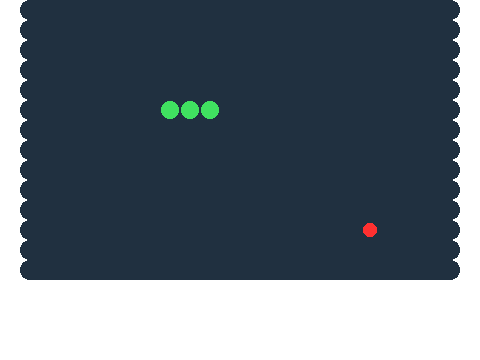

# wasm2sb3

**A compiler from WebAssembly to plain Scratch 3 blocks, which runs C, Python and Doom inside Scratch.**

> [!NOTE]
> **This project was written by Claude**, Anthropic's AI model, working in
> [Claude Code](https://claude.com/claude-code). Claude designed and wrote the
> compiler, the WebAssembly interpreter, the MicroPython port, the Doom
> platform layer, the tests, the examples and this README. A human set the
> goals, ran the sessions and tested the results. Commits are co-authored
> by Claude.

wasm2sb3 compiles WebAssembly into a native Scratch 3 project (`.sb3`). Every
WebAssembly function becomes a custom block made of ordinary Scratch blocks:
operators, variables, lists, `if` and `repeat until`. The output contains no
extensions and no JavaScript, so it runs on scratch.mit.edu, in TurboWarp and
in the offline editor.

C compiles to WebAssembly, so real C programs run in Scratch, including
`printf`, `malloc`, `qsort` and libm. From there it reaches further:

| | |
|---|---|
| 🐍 **A Python REPL in Scratch** | MicroPython 1.29, with classes, generators, bignums and exceptions, all as Scratch blocks |
| 💾 **Saveable on scratch.mit.edu** | a WebAssembly interpreter written in C is compiled to Scratch, and the hot paths are compiled natively, to fit under the 5 MB limit |
| 🎨 **Python ↔ Scratch** | a `scratch` module for pen, mouse, keyboard and speech bubbles; see the [examples](#python-examples) |
| 👹 **Doom** | doomgeneric drawn with the Pen extension; see [doom/](doom/) |
| ✅ **Differential testing** | every test runs in Node's WebAssembly and in a headless scratch-vm, and the outputs must match exactly |

**Contents:** [Quick start](#quick-start) · [Python in Scratch](#python-in-scratch) ·
[Doom](#doom-in-scratch) · [Usage](#usage) · [How it works](#how-it-works) ·
[Testing](#testing) · [Limitations](#limitations) · [Repository layout](#repository-layout) ·
[Credits](#credits)

## Quick start

To try it without building anything, download any `.sb3` in
[examples/](examples/) and open it in [TurboWarp](https://turbowarp.org) or
the Scratch editor (*File → Load from your computer*).

To build from source:

```
npm install
npm test
node bin/wasm2sb3.js examples/queens.c --run     # needs wasi-sdk, see Usage
```

```
$ node bin/wasm2sb3.js examples/queens.c --run
4-queens: 2 solutions
5-queens: 10 solutions
6-queens: 4 solutions
7-queens: 40 solutions
...                     (an ASCII Mandelbrot set follows)
```

## Python in Scratch

`examples/micropython.sb3` is a real Python REPL ([MicroPython](https://micropython.org)
1.29 with floats, bignums, classes, generators, exceptions and `math`),
compiled from C by this compiler into ordinary Scratch blocks. Type at the
"ask" prompt; output scrolls in the list on stage:

```
>>> def fib(n):
...     return n if n < 2 else fib(n - 1) + fib(n - 2)
...
>>> fib(15)
610
>>> 2 ** 100
1267650600228229401496703205376
```

Load it with *File → Load from your computer* in the Scratch editor or
TurboWarp. At ~17 MB of project.json it is too large to *save* to
scratch.mit.edu (the server limit is about 5 MB). The first command takes a
few seconds while Scratch looks up each custom block for the first time;
after that, simple lines take a fraction of a second.

### Python runner: code in a list

[examples/python/python_runner.sb3](examples/python/python_runner.sb3) is a
generic Python project. The program is the **Python code** list on the left
of the stage, one line per item. Click an item to edit it, use **+** to add
lines, then click the green flag to run it. Output appears in the `stdout`
list on the right, `input()` uses the ask box, and traceback line numbers are
list item numbers. Ordinary Scratch blocks can also add, replace or delete
items, so a project can build Python code before running it.

Indent with spaces. To see pen drawings, untick the two lists in the
Variables category so they stop covering the stage. Rebuild it with
`python/build.sh --list [default.py]`; under the hood, the compiler's
`scratch.script_lines`/`script_line` imports read the list and the driver
runs whatever it holds.

### Saveable versions: a WebAssembly interpreter in Scratch

The directly compiled Python projects are about 19 MB of `project.json`, too
big to save on scratch.mit.edu (about 5 MB). [interp/wasmi.c](interp/wasmi.c)
is a small WebAssembly interpreter written in C. It is compiled with this
compiler like any other program, and MicroPython's `.wasm` is embedded in it
as data. So the stack is Scratch blocks → compiled interpreter → MicroPython
bytecode → Python.

| | directly compiled | interpreted |
|---|---|---|
| `project.json` | ~19 MB | **~4.1 MB** (saveable) |
| blocks | ~129,000 | ~16,500 (the editor stays responsive) |
| MicroPython startup (scratch-vm) | ~9 s to the first answer | ~10 s |
| speed after warm-up | 1× | ~19× slower (~15,000 wasm instructions/s) |

- `examples/python/python_runner_interpreted.sb3` is the list-based Python
  runner.
- `examples/micropython_interpreted.sb3` is the REPL.

The interpreter runs the module's bytecode in place, and keeps guest
functions, labels and exceptions on explicit stacks (no C recursion per
guest call). It forwards WASI and `scratch.*` imports to the host. It also
gives the guest's garbage collector exact roots: every guest value lives in
the interpreter's stacks. Build one with:

```
interp/build.sh guest.wasm name                      # interp/build/name.wasm
SB3=1 interp/build.sh guest.wasm name                # ... and name.sb3
CFLAGS="-DREACTOR -mexec-model=reactor" SB3=1 interp/build.sh runner.wasm name   # start/frame guests
node interp/test.mjs                                 # each test guest, direct vs interpreted
```

### Hybrid: interpreted, with the hot paths compiled

`python/build.sh --hybrid` builds `python_runner_hybrid.sb3`, the list runner
as a hybrid. It is under 5,000,000 bytes of `project.json`, so it can be saved
online, and it is much faster than the interpreted version. Most of MicroPython
stays interpreted bytecode. The 90 functions where it spends its time
(`mp_execute_bytecode`, `mp_binary_op`, `mp_map_lookup`, the parser, the
allocator...) are translated from wasm to C by
[interp/w2c.mjs](interp/w2c.mjs). They are compiled into the interpreter and
so become ordinary Scratch blocks.

- **Calls:** native code calls other native functions directly. It calls
  interpreted ones through the interpreter, and the interpreter calls native
  ones through a dispatch switch.
- **Exceptions** (MicroPython's `nlr`, i.e. wasm `try`/`throw`): a throw sets
  a pending flag and jumps to the innermost handler. Calls that may throw test
  the flag, and the interpreter picks up an exception that escapes native code.
- **GC roots:** native locals are Scratch variables, so they are reported
  through the host's own `gc_roots_*`, together with the interpreter's stacks.

Measured on `interp/bench/mix.py` (calls, loops, strings, dicts, floats,
classes, exceptions, generators), output identical in each:

| | directly compiled | interpreted | hybrid |
|---|---|---|---|
| `project.json` | ~19 MB | ~4.1 MB | **4.96 MB** (saveable) |
| TurboWarp, whole program | 63 s | 235 s | **7.5 s** |
| scratch-vm, `runner_default.py` | ~9 s | ~10 s | 8.6 s |

The directly compiled project loses most of its time to the size of the
project itself. Deep recursion raises `RuntimeError: maximum recursion
depth exceeded`; the pure interpreter runs out of its own control stack
first.

The pieces:

| file | role |
|---|---|
| [interp/profile.mjs](interp/profile.mjs) | per-function instruction and call counts under the interpreter (`-DPROFILE_FUNCS`) |
| [interp/select.mjs](interp/select.mjs) | picks functions by profiled work per byte of `project.json`, up to a budget |
| [interp/python_native.txt](interp/python_native.txt) | the chosen list |
| [interp/w2c.mjs](interp/w2c.mjs) | guest wasm → C for those functions |
| [interp/embed.mjs](interp/embed.mjs) | embeds the guest, with native bodies stripped |
| [interp/prune.mjs](interp/prune.mjs) | drops interpreter cases for opcodes and imports the remaining guest code never uses |
| [interp/hybrid.sh](interp/hybrid.sh) | builds it all: `SB3=1 interp/hybrid.sh guest.wasm funcs.txt name` |
| [interp/difftest.mjs](interp/difftest.mjs), [interp/vmtest.mjs](interp/vmtest.mjs) | compare builds in Node; run a `.py` in scratch-vm or TurboWarp (`TW_VM=...`) |

The project is compiled with `wasm2sb3 --minify`, which you can use on any
program. It does the following:

- gives variables, lists, custom blocks and arguments short names
- drops the hidden default value under inputs that hold a reporter
- drops null `next` links
- builds the `and8`/`fpow2` tables at the green flag
- stores the memory image as runs of non-zero words, and builds memory at
  the green flag when it fits Scratch's 200,000-item list limit

`--gc-roots REGEX` limits GC roots to matching variables.

### Python examples

[examples/python/](examples/python/) has Python programs bundled into
projects. Each one runs when you click the green flag:

| | |
|---|---|
|  **spirograph.py**: hypotrochoid curves drawn live by a generator; click for a random one |  **tree.py**: a recursive generator grows a fractal tree; click to grow another |
|  **paint.py**: paint with the mouse in cycling colours; space/b change the brush, c clears |  **snake.py**: steer with the arrow keys, eat apples, don't bite yourself |

**learn_python.py** is an interactive beginner tutorial. Eight short
lessons (print, variables, maths, strings, lists, if, loops, functions) each
end with a challenge. You type real Python into the ask box, it runs, and the
lesson checks what your code did; `hint` and `skip` are available. Afterwards
you can keep typing Python.

**adventure.py** is a small text adventure ("Escape the Stage") played
through the ask box.

Python talks to Scratch through the `scratch` module:

```python
import scratch
scratch.pen_color(255, 0, 0)          # or 0xFF0000; pen_hue(0..100); pen_size(n)
scratch.line(-100, 0, 100, 0)         # also: goto, pen_down, pen_up, dot, stamp, clear
scratch.say("hi")                     # speech bubble
scratch.mouse_x(), scratch.mouse_down(), scratch.key_pressed("left")
scratch.timer(), scratch.clock()      # Scratch timer / wall clock (seconds)
scratch.randint(1, 6)
scratch.on_frame(fn)                  # call fn() every frame, with a screen refresh in between
```

Everything runs in "run without screen refresh" mode, so animations should
do a frame's worth of work in an `on_frame` callback. The examples step a
generator for about 30 ms per frame (measured with `scratch.clock()`).

To build your own, put wasi-sdk and the MicroPython source in `toolchain/`,
then run:

```
python/build.sh my_program.py         # -> python/build/my_program.sb3
python/build.sh --sb3                 # the REPL
```

`node scripts/snapshot.mjs project.sb3 out.png` runs a project headlessly
and saves what the pen drew. It can also script mouse, keyboard and ask-box
input, which is how the previews above were made.

How the port works: [python/](python/) holds a small driver (`main.c`), the
`scratch` module (`modscratch.c`) and a MicroPython configuration. The
garbage collector can run at any time, because every wasm local is a Scratch
variable. The compiled program hands all of them, plus saved call frames, to
MicroPython's GC as roots, together with the C stack in linear memory.

## Doom in Scratch

[doom/](doom/) builds [doomgeneric](https://github.com/ozkl/doomgeneric) with
the shareware WAD into a Scratch project. The project uses only ordinary
blocks and draws with the Pen extension. Doom runs in low-detail mode, and
only the 160×100 pixels the pen can show are rendered. A virtual 35 Hz clock
slows the game down when Scratch can't keep up, so no tics are skipped. The
project is about 55 MB, so load it from a file in TurboWarp. The Doom source
and WAD are not checked in; [doom/README.md](doom/README.md) explains how to
get them, build the project, and play it.

## Why WebAssembly (not LLVM IR)

WebAssembly is a small, stable, fully specified stack machine with about 200
instructions. Its control flow is already structured (`block`/`loop`/`if`,
with no arbitrary gotos), which maps well onto Scratch's C-shaped blocks.
LLVM IR is larger, changes between LLVM versions, and has an unstructured
CFG that would need a "relooper" pass. Any language that targets WebAssembly
(C, C++, Rust, Zig, AssemblyScript, ...) works through this compiler.

## Usage

```
node bin/wasm2sb3.js program.wasm            # -> program.sb3
node bin/wasm2sb3.js program.wat             # text format (needs the wabt package)
node bin/wasm2sb3.js program.c               # C, via wasi-sdk (see below)
node bin/wasm2sb3.js program.c --run         # also run it headlessly in scratch-vm
node bin/wasm2sb3.js prog.c --run --stdin "42"   # input for ask-and-wait
```

Options: `-o out.sb3`, `--entry NAME`, `--cflags "..."`, `--json project.json`, `-q`.

To compile C, unpack [wasi-sdk](https://github.com/WebAssembly/wasi-sdk/releases)
into `./toolchain/` or set `WASI_SDK_PATH`. Or build the `.wasm` yourself:

```
$WASI_SDK/bin/clang -O2 -o prog.wasm prog.c
```

As a library:

```js
import { compileWasm } from './src/index.js';
const { sb3, warnings, stats } = compileWasm(fs.readFileSync('prog.wasm'));
```

### Programs and I/O

| WebAssembly side | Scratch side |
|---|---|
| `_start` / `main` export | runs when the green flag is clicked |
| `_initialize` + `frame` exports (reactor) | `frame` is called once per Scratch frame, for animation |
| WASI `fd_write` (stdout/stderr) | lines appended to the `stdout` list shown on stage |
| WASI `fd_read` (stdin) | "ask and wait"; each answer is one line |
| WASI `proc_exit`, `clock_time_get`, `random_get`, args, environ | supported |
| `scratch.*` imports ([include/scratch.h](include/scratch.h)) | pen, go to x/y, say, mouse, keys, timer, wait |

Examples are in [examples/](examples/): `micropython` (see [Python in Scratch](#python-in-scratch)), `hello`, `queens`, `guess` (stdin),
and `bounce` (pen animation, built with
`--cflags "-O2 -mexec-model=reactor -Wl,--export=frame"`). The `.sb3` files
next to them are ready to load in Scratch.

## How it works

The pipeline is: binary parser → analyses → per-function code generator →
Scratch block tree → `project.json` + zip.

- **Values.** Scratch only has doubles. An `i32` is held as an unsigned
  integer in [0, 2³²), and an `i64` as two such halves. Wrap-around uses
  `mod 4294967296`. Shifts become multiplications or floored divisions by
  powers of two. `and`/`or`/`xor` use arithmetic identities when one side is a
  constant mask, and otherwise a 256×256 lookup table. Every expression
  carries a known-bits mask, so redundant `mod`s are dropped. `f64` maps
  directly to Scratch numbers. `f32` results are rounded to single precision
  with Veltkamp splitting. Reinterpreting floats as bits uses exact
  power-of-two tables.
- **Memory** is the list `mem`, one 32-bit word per item. Aligned loads and
  stores are a single list read or write. Byte and halfword accesses are done
  arithmetically. Under-aligned accesses go through byte-wise helpers.
- **Expressions, not stack traffic.** The code generator keeps a symbolic
  operand stack, so `a + b * c` becomes one nested reporter. A value is
  written to a variable only when something would change what it reads: a
  store, a call, a write to a local it uses, or a control-flow merge.
- **Control flow.** Branches out of blocks set a `br` variable. The code after
  a branch goes either into the `else` arm of that branch's own `if`, or
  under `if br = 0`. Loops are `repeat until not (br = L)`. A `return` is
  `stop this script`. Blocks that nothing branches to are compiled in line,
  and `br_table` becomes a binary search of `if`s.
- **Exceptions** (the WebAssembly exception-handling proposal, which is
  what clang uses for `setjmp`/`longjmp`). A `throw` stores the tag and
  payload in variables and unwinds to the enclosing `try` handler through the
  same `br` mechanism. Calls to functions that may throw are followed by a
  check that keeps unwinding.
- **Functions** are custom blocks with "run without screen refresh" enabled.
  Locals are sprite variables. For recursive call cycles (found with Tarjan's
  SCC algorithm), the caller's live locals (from a liveness analysis) are
  pushed to a list before each call and popped after it. Functions with
  many such locals share one save/restore procedure pair to keep projects
  small. Procedure definitions are written first in `project.json`, because
  the VM finds them with a linear scan on first use.

## Testing

```
npm test
```

Every test runs twice, natively in Node's WebAssembly and as a compiled
project in a headless scratch-vm, and the results must match exactly:

- About 60 generated modules that run each integer operator on edge-case
  inputs, in several operand shapes.
- Float operators, conversions and bit reinterpretation (~16k values).
- Hand-written programs covering control flow, recursion, memory, indirect
  calls and stdin.
- The C programs in `test/c/`, built at both `-O2` and `-O0` (skipped when
  wasi-sdk isn't present).
- MicroPython REPL sessions in `test/python/`, when `python/build.sh` has
  been run.

## Limitations

- **NaN.** Scratch turns NaN into 0, so NaN payloads and NaN results are not
  preserved. Infinities and `-0` are preserved. (The pure interpreter keeps
  NaN, because it stores floats as bits; the hybrid's compiled float code
  does not.)
- **Traps.** Integer division by zero and out-of-bounds memory accesses are
  not detected. `unreachable` and bad indirect calls do trap: a message
  appears in `stdout` and the project stops.
- **Memory size.** Scratch caps lists at 200,000 items, so `memory.grow`
  fails past about 780 KB. The initial memory can be larger.
- **Alignment.** Alignment hints are trusted. clang only emits natural
  alignment when it is guaranteed.
- **f32 rounding.** Subnormal `f32` results and `i64 → f32` conversions can
  differ from IEEE in the last bit (double rounding).
- **Text output** is ASCII/Latin-1; other characters print as `?`. stdin has
  no EOF.
- **Not supported:** SIMD, threads/atomics, the newer `try_table`/`exnref`
  exception instructions (the legacy `try`/`catch` form that clang emits by
  default is supported), multiple memories or tables,
  `table.get`/`table.set`, and passive data segments.
- **Size.** Large programs make large projects. scratch.mit.edu only saves
  project.json files under about 5 MB, but bigger projects still load from a
  file.
- **Speed.** Speed depends on the player. TurboWarp's compiler runs these
  projects much faster than vanilla Scratch.

## Repository layout

```
bin/wasm2sb3.js        command-line entry point
src/wasm/              WebAssembly binary parser and opcode table
src/compiler/          analyses (SCC, liveness, known bits) and the code generator
src/scratch/           Scratch block AST, project.json serializer, .sb3 writer
src/vm.js              headless scratch-vm runner used by --run and the tests
include/scratch.h      C header for the scratch.* imports (pen, mouse, keys...)
examples/              C and Python examples, with ready-to-load .sb3 files
python/                MicroPython port: driver, `scratch` module, config, build.sh
interp/                WebAssembly interpreter in C, plus the hybrid wasm-to-C pipeline
doom/                  Doom platform layer and build script
scripts/               headless snapshot tool and a static server for .sb3 files
test/                  differential test suite (generated, .wat, C and Python)
```

`toolchain/` (wasi-sdk, MicroPython source) and all `build/` directories are
local and ignored by git.

## Credits

**Written by [Claude](https://www.anthropic.com/claude)** (Anthropic), working
in [Claude Code](https://claude.com/claude-code): the compiler, the
interpreter, the hybrid pipeline, the ports, the tests and the documentation.
The project was directed and tested by a human collaborator.

The project builds on:

- [MicroPython](https://micropython.org) (MIT)
- [wasi-sdk](https://github.com/WebAssembly/wasi-sdk) and [wabt](https://github.com/WebAssembly/wabt)
- [scratch-vm](https://github.com/scratchfoundation/scratch-vm), used for headless testing
- [doomgeneric](https://github.com/ozkl/doomgeneric) (GPL v2, downloaded at build time, not included)

Scratch is a project of the Scratch Foundation, which is not affiliated with
this project.

## License

MIT; see [LICENSE](LICENSE). Third-party components keep their own licenses.
